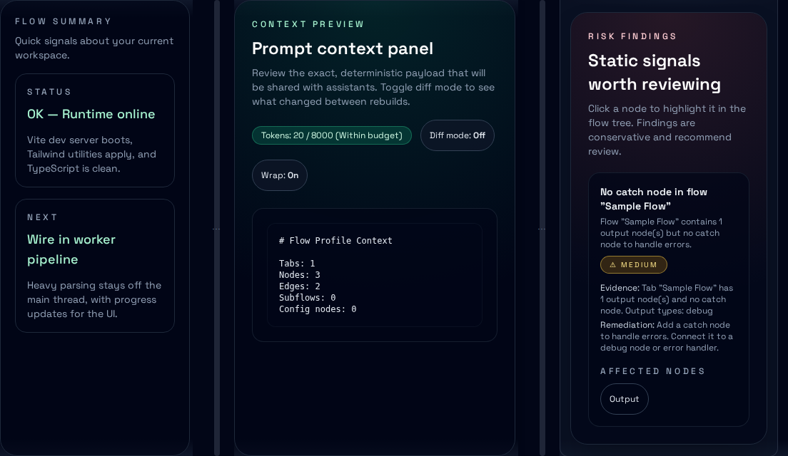
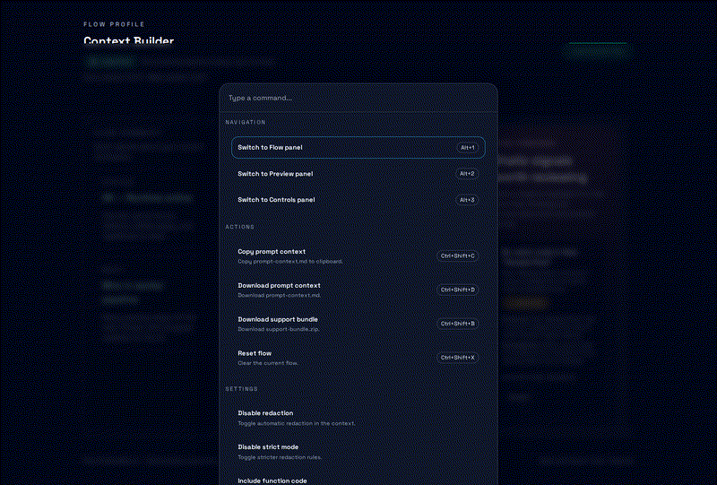
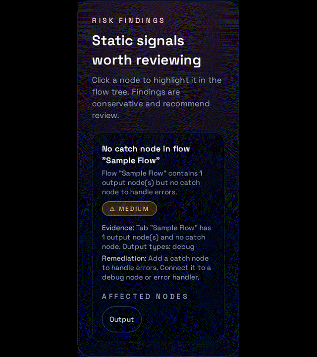

# Flow Profile v8.2

[](LICENSE)
[](https://nodejs.org/)
[](https://bun.sh/)
[](https://github.com/yuan-cloud/flow-profile/actions/workflows/ci.yml)

Deterministic, local-first context hygiene for flow-based automation exports. Flow Profile produces redacted, budgeted context bundles and an auditable UI that shows exactly what would be shared with an AI assistant or support engineer — without sending data off-machine.



## Why it matters

- Deterministic outputs reduce review drift and make troubleshooting repeatable.
- Redaction-first processing lowers accidental data exposure risk before sharing.
- CLI + web parity supports both CI pipelines and human audit workflows.

## Who it's for

Flow Profile is for teams operating flow-based automation exports who need deterministic, shareable context bundles with clear governance boundaries, including:

- Node-RED-compatible `flows.json` exports
- Low-code automation tools with graph exports
- Systems that need redaction-first summaries before sharing

## Features

- **Deterministic bundles** — identical input produces identical output, byte-for-byte
- **Redaction-first pipeline** — secrets are stripped before any optional AI usage
- **Risk detection (SARIF)** — flags exec nodes, insecure HTTP endpoints, and other hazards
- **Token budgeting** — enforces model limits with configurable strategies
- **Capability manifest** — machine-readable summary of what flows can do
- **Subflow expansion** — inlines subflows for complete context
- **Web UI** — auditable, drag-and-drop Vue 3 app
- **Command palette + shortcuts** — fast navigation and export operations
- **Resizable panels** — adjustable three-column workspace layout
- **CLI** — scriptable `build`, `lint`, and `doc` commands for CI pipelines
- **Isomorphic core** — runs in Node.js and browsers (no native dependencies)
- **AI adapters (optional)** — provider-agnostic layer that consumes redacted bundles

## Security & Governance

- **Local-first by default** — bundles are generated on-device with no required network calls.
- **Redaction-first pipeline** — secrets are removed before any optional AI usage.
- **Auditable outputs** — users can inspect exactly what is shared.
- **Deterministic artifacts** — identical input yields identical outputs for repeatable review.

## Architecture

### Monorepo layout

| Package | Description |
|---------|-------------|
| `@flow-profile/core` | Isomorphic core logic — browser compatible, no Node.js APIs |
| `@flow-profile/cli` | Command-line interface (`build`, `lint`, `doc`) |
| `@flow-profile/ui` | Reusable Vue 3 components |
| `@flow-profile/ai` | Optional vendor-agnostic AI adapters |
| `@flow-profile/web` | Vue 3 Context Builder web application |

### Processing pipeline

```
flows.json
  → parse        — schema-validated ingestion
  → categorize   — group nodes by purpose
  → expand       — inline subflows
  → redact       — strip credentials & secrets
  → detect risks — flag security concerns
  → budget       — fit to token limits
  → output       — generate bundle artifacts
```

## Quick Start

### Prerequisites

- [Node.js](https://nodejs.org/) >= 20
- [Bun](https://bun.sh/) >= 1.1

### Install

```bash
git clone <repo-url>
cd flow-profile
bun install
```

### CLI

```bash
# Build a context bundle
bun run --cwd packages/cli build
node packages/cli/dist/cli.js build --in ./flows.json --out-dir ./out

# Lint flows for issues
node packages/cli/dist/cli.js lint --in ./flows.json

# Generate documentation
node packages/cli/dist/cli.js doc --in ./flows.json --out ./runbook.md
```

The CLI runs from source in this repo; build it first with `bun run --cwd packages/cli build`.
The CLI is not published yet; install and run from source.

Lint configuration can be provided via a `.flowprofilerc.json` file in the working directory or an explicit `--config` path.

### Web UI

```bash
bun run dev
```

Open http://localhost:5173 and drag-drop a `flows.json` file.

## Demo GIFs





### Project scripts

```bash
bun run test        # run tests (vitest)
bun run lint        # lint (biome)
bun run build       # build all packages
bun run typecheck   # typescript validation
bun run format      # format code
```

On VPS hosts, `bun run build` is most reliable when run locally or in CI due to shared resource limits.

## Output Artifacts

| File | Description |
|------|-------------|
| `about-my-flows.json` | Human-readable flow summary |
| `bundle-manifest.json` | Deterministic content-addressed manifest |
| `capability-manifest.json` | Machine-readable capability inventory |
| `prompt-context.md` | Markdown context ready for assistant consumption |
| `risk-findings.json` | Security risk findings in SARIF format |
| `support-bundle.zip` | All artifacts in a single distributable archive |

## Documentation

- [Installation](docs/installation.md)
- [CLI reference](docs/cli.md)
- [Web app guide](docs/web.md)
- [Configuration](docs/config.md)
- [Architecture](docs/architecture.md)
- [AI adapter strategy](docs/ai.md)
- [Testing](docs/TESTING.md)
- [CI examples](docs/ci/README.md)

## Why it exists

This is middleware for safe, deterministic context preparation. It is valuable with AI disabled and stays local-first by design. This repo does not modify or interact with Node-RED or FlowFuse repositories. See [External Repo Safety](docs/EXTERNAL_REPO_SAFETY.md).

## License

[MIT](LICENSE) — (c) 2026 Yuan Liu
