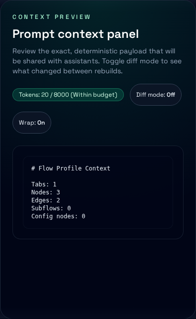

# Web App Guide

The web app processes Node-RED flow exports in a browser worker. It applies the core redactor before building summaries, risk findings and the context used for preview and export. It does not send flows to a server for analysis; optional external AI providers require opt-in.



## Getting started

```bash
bun run dev
```

Open http://localhost:5173 and drag drop a Node-RED export (`flows.json`).

## UI walkthrough

The UI has four states:

- Empty state with drop zone and quick explanation.
- Loading state with progress and cancel.
- Parsed view with a three-column layout for summary, context preview, and findings.
- Error state with a readable message and remediation tips.

The three-column layout supports resizable panels for the flow summary and controls columns.

## Working with the flow

Typical flow:

1. Drop a `flows.json` export.
2. Review the summary and token meter.
3. Inspect the Redaction Report (field paths, reasons and masks, without original values) and risk findings. Click an affected node to include its sanitized label in the prompt context.
4. Adjust redaction settings as needed. Redaction and strict mode start enabled, with an entropy threshold of 4.5. Strict mode off disables entropy scanning while retaining field-name matching. A higher threshold masks fewer strings. Turning redaction off can expose secrets; the settings panel and export panel warn about this.
5. Wait for rebuilding to finish and review the prompt again. Changes to privacy settings clear the old preview and diff history immediately; copy/download is unavailable until the new output is ready. Cancellation does not restore the old output.
6. Copy or download `prompt-context.md`, or download individual JSON artifacts. The ZIP contains those same four artifacts plus `bundle-manifest.json`, which records the applied settings and artifact hashes. The prompt preview covers the Markdown, not all JSON contents.

## Privacy and current limitations

- Web and CLI `build` use the same core redactor and defaults. They do **not** currently produce equivalent artifacts: the web summary is count-based, its capability manifest has empty tool/resource lists, and its prompt adds selected/excluded node and collapsed-subflow labels. Function-code inclusion is not implemented in web output. The web token budget is an estimate/warning, not a hard output limit.
- Redaction is heuristic, not a guarantee. It masks string values in matching fields and eligible strings above the entropy threshold. It does not rename object keys. Entropy scanning skips strings containing whitespace, short strings, UUIDs, dates, versions and some short base64-like strings. Ordinary prose or sensitive labels that do not match these rules can remain; inspect before sharing.
- Raw input stays in browser memory for rebuilding and is cleared by Reset. The ZIP does not include the original flow. Reset or re-enabling redaction cannot recall anything already copied, downloaded or sent to a provider.
- The app requests Google Fonts. External AI providers can receive generated context when explicitly enabled and requested; these requests are separate from local processing. Do not enable them with redaction disabled unless you intend to share that output.
- Redaction may mask legitimate values. Risk findings are generated from the sanitized flow, so masking can change which risks are detected. An empty report or an absence of findings does not establish that an export is safe.

## Keyboard and accessibility

The UI is designed for keyboard use and accessible navigation:

- Use Tab and Shift+Tab to move between controls.
- Use Enter or Space to activate focused controls.
- Focus states are visible and severity is not conveyed by color alone.

Keyboard shortcuts:

- `Mod+K` open command palette
- `Mod+Shift+C` copy prompt context
- `Mod+Shift+D` download prompt context
- `Mod+Shift+B` download support bundle
- `Mod+Shift+X` reset flow
- `Alt+1` switch to Flow panel
- `Alt+2` switch to Preview panel
- `Alt+3` switch to Controls panel

## Recommended screenshots

The user-facing docs expect screenshots for key states. Capture and place images in a `docs/assets/screenshots/` folder if you add them:

- Empty state
- Parsed view (three columns)
- Risk findings expanded
- Export options

Optional automation (run on a machine that can launch Chromium):

```bash
DOCS_CAPTURE=1 DOCS_CAPTURE_URL=http://127.0.0.1:5173 bun run test:e2e -- --config playwright.docs.config.ts --project=chromium -g "docs capture"
```
